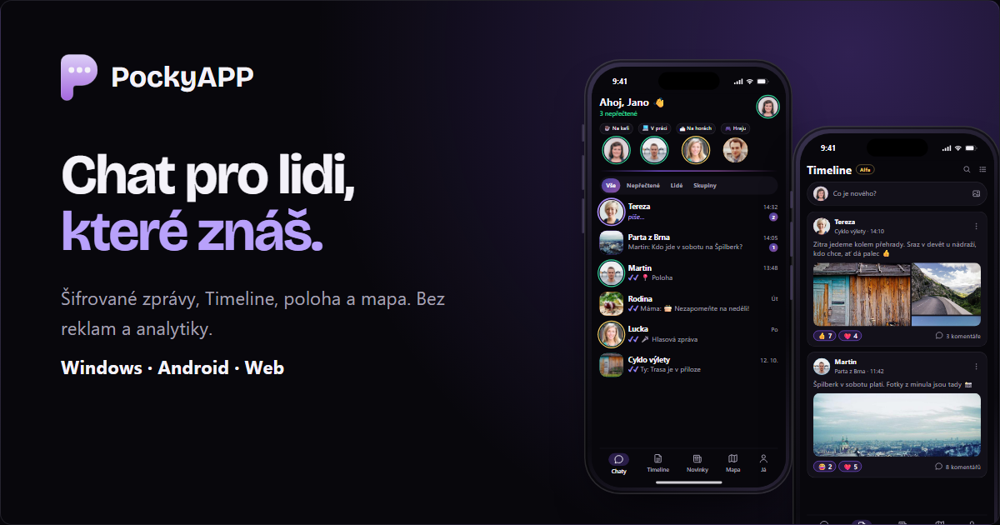
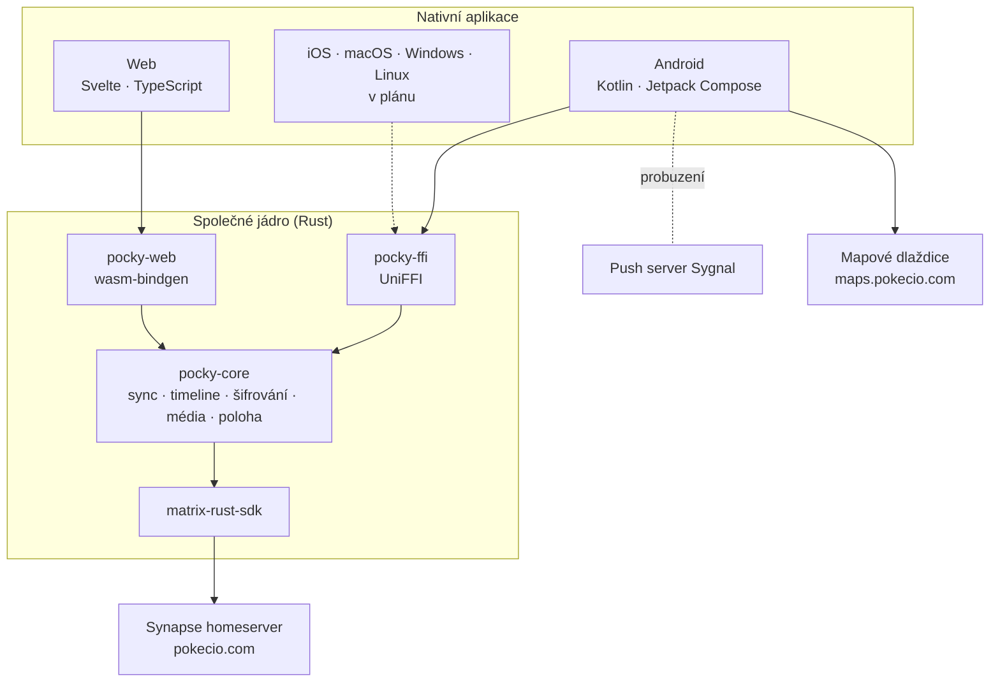

<div align="center">


# PockyAPP

**Soukromý chat s end-to-end šifrováním pro komunitu Pokecio.**

Nativní Matrix klient se společným jádrem v Rustu. Bez reklam, bez analytiky, bez sledování.

[pokecio.com](https://pokecio.com) · [Webová aplikace](https://app.pokecio.com) · [English](README.md)




</div>

---

## O projektu

PockyAPP je chatovací aplikace komunity Pokecio. Mluví otevřeným protokolem
[Matrix](https://matrix.org), takže si lidé v PockyAPP můžou psát s kýmkoli v Elementu nebo jiném
Matrix klientovi, i šifrovaně.

Veškerá logika chatu je v jednom jádře v Rustu nad
[matrix-rust-sdk](https://github.com/matrix-org/matrix-rust-sdk), na stejném základu jako Element X.
Každá platforma nad ním jen kreslí vlastní nativní rozhraní: na Androidu Kotlin a Jetpack Compose,
na webu Svelte s WebAssembly a jako další přijdou SwiftUI, WinUI a GTK.

## Soukromí na prvním místě

- **Šifrování ve výchozím stavu.** Zprávy, soubory, fotky i hlasovky se šifrují už v zařízení.
- **Žádná analytika, sledování ani reklamy.** Aplikace nesbírá data o používání a nic nikomu
  neprodává.
- **Žádné další servery s tvými daty.** Jen Matrix homeserver, push server, který předává signál
  bez obsahu, a statický web.
- **Oznámení se dešifrují v telefonu.** Firebase jen zazvoní, text zprávy přes Google nejde.
- **Vlastní mapový server.** Mapy jsou z vlastního serveru pro Česko a Slovensko, ne z Google Map.
- **Aktualizace bez Google Play.** Každá aktualizace se před instalací ověří podle SHA-256
  a podpisového certifikátu.

## Funkce

| Oblast | Co umí |
|---|---|
| **Chaty** | Chaty 1:1 i skupiny, pozvánky, odpovědi, úpravy, mazání, libovolné emoji jako reakce, „píše…“, potvrzení přečtení s časem, informace o zprávě, přeposílání |
| **Média** | Fotky bez EXIF, volba plné kvality, videa, soubory, hlasovky se skutečnou vlnou a poslechem před odesláním, GIFy z klávesnice |
| **Album chatu** | Fotky, videa, hlasovky a dokumenty po měsících, informace o souboru, uložení do galerie, sdílení, přeposlání, stažení celého alba |
| **Šifrování** | Ověření zařízení přes emoji, ověřování dalších lidí, štíty u zpráv, záloha klíčů odemykaná bezpečnostní frází, nová identita, když je vše ztracené |
| **Zabezpečení** | Zámek aplikace PINem a otiskem, zákaz snímků obrazovky, změna hesla, smazání účtu |
| **Přítomnost** | Aura kolem avataru podle stavu online, vlastní stavy s platností, sdílení řízené v každém zařízení zvlášť |
| **Poloha** | Jednorázová i živá poloha s volitelnou přesností, sdílení na pozadí, záložka Mapa |
| **Zážitek** | Rozložení pro telefon i tablet, průvodce po přihlášení, plynulé přechody, aktualizace v aplikaci s přehledem novinek |

## Architektura



Základní pravidlo projektu: **v UI vrstvě není logika.** Co by potřebovaly dvě platformy, patří do
jádra. Každý nový klient tak dostane stejné chování, stejné šifrování a stejné opravy.

## Struktura repozitáře

```
core/
  pocky-core/        logika nad matrix-rust-sdk
  pocky-ffi/         UniFFI vrstva pro nativní platformy
  pocky-web/         most do prohlížeče přes WebAssembly
  uniffi-bindgen/    generátor bindingů
apps/
  android/           aplikace pro Android (Kotlin, Jetpack Compose)
  web/               webová aplikace (Svelte, TypeScript, Vite)
  apple/             připraveno pro iOS a macOS
design/              barvy značky a sada ikon
docs/handbook/       příručka pro vývoj (česky, anglicky v en/)
scripts/             skripty pro sestavení, vydání a nasazení
```

Web pokecio.com se vyvíjí zvlášť a v tomto repozitáři není.

## Jak začít

**Potřeba:** Rust stable, `cargo-ndk`, Android Studio se SDK 37 a NDK 30, Node.js pro webové
projekty. Celý postup je v [docs/handbook/setup.md](docs/handbook/setup.md).

```sh
# společné jádro
cargo build
cargo test
cargo clippy --all-targets

# Android (jádro v Rustu a Kotlin bindingy se sestaví samy)
cd apps/android
./gradlew assembleDebug

# webová aplikace
scripts/build-web.sh
```

Živé testy proti skutečnému serveru se spouštějí jen na vyžádání a přihlašovací údaje berou pouze
z proměnných prostředí. Viz [docs/handbook/testing.md](docs/handbook/testing.md).

## Vlastní nasazení

Webová aplikace funguje s libovolným Matrix homeserverem, který povoluje přihlášení heslem.
Sestavíte ji s vlastním serverem jako výchozím, nebo necháte lidi vybrat server na přihlašovací
obrazovce – viz [docs/handbook/self-hosting.md](docs/handbook/self-hosting.md). K jinému serveru se
umí přihlásit i aplikace pro Android.

## Dokumentace

Příručka v [docs/handbook](docs/handbook) popisuje architekturu, API jádra, FFI vrstvu, Android
a web, bezpečnostní rozhodnutí, push server, testování a řešení problémů.

## Stav

PockyAPP je v **otevřené betě**. Android a webová aplikace se denně používají, další na řadě jsou
iOS a desktop. Plánovaná práce je v [roadmapě](docs/handbook/roadmap.md).

## Bezpečnost

Máš podezření na bezpečnostní chybu? Napiš prosím na **dev@pokecio.com** dřív, než ji zveřejníš.
Viz [SECURITY.md](SECURITY.md).

## Autor

Návrh a vývoj **Karel Zelenka** ([eHappyCZ](https://github.com/eHappyCZ)).

## Licence

PockyAPP je svobodný software pod licencí [GNU Affero General Public License v3.0](LICENSE).
© 2026 Karel Zelenka.
