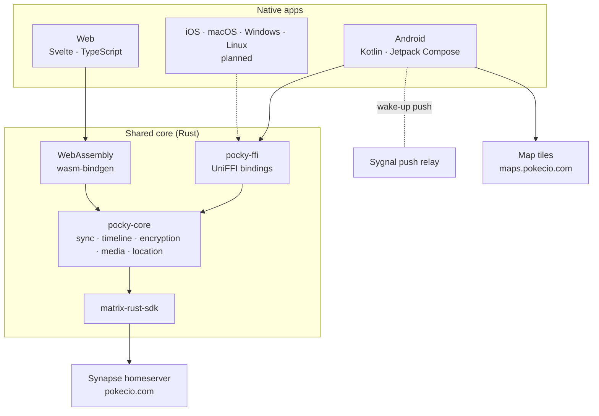

<div align="center">


# PockyAPP

**A private, end-to-end encrypted chat for the Pokecio community.**

Native Matrix client with a shared Rust core. No ads, no analytics, no tracking.

[pokecio.com](https://pokecio.com) · [Web app](https://app.pokecio.com) · [Česky](README.cs.md)


</div>

---

## About

PockyAPP is the chat app of the Pokecio community. It speaks the open
[Matrix](https://matrix.org) protocol, so people on PockyAPP can talk to anyone on Element or any
other Matrix client, including encrypted conversations.

All chat logic lives in one Rust core built on
[matrix-rust-sdk](https://github.com/matrix-org/matrix-rust-sdk), the same foundation as Element X.
Each platform only draws its own native interface on top of it: Kotlin and Jetpack Compose on
Android, Svelte with WebAssembly on the web, and SwiftUI, WinUI and GTK planned next.

## Privacy first

- **End-to-end encryption by default.** Messages, files, photos and voice messages are encrypted on
  the device before they leave it.
- **No analytics, no tracking, no ads.** The app does not collect usage data and does not sell
  anything to anyone.
- **No extra servers with your data.** Only the Matrix homeserver, a push relay that carries a
  wake-up signal without content, and a static website.
- **Notifications are decrypted on the phone.** Firebase only rings the bell; the text never goes
  through Google.
- **Own map server.** Maps come from a self-hosted tile server covering the Czech Republic and
  Slovakia, not from Google Maps.
- **Updates outside Google Play.** Each update is checked against its SHA-256 hash and the signing
  certificate before it is installed.

## Features

| Area | What's included |
|---|---|
| **Chats** | 1:1 and group chats, invites, replies, edits, deletions, any emoji as a reaction, typing indicator, read receipts with time, message info, forwarding |
| **Media** | Photos without EXIF, full-quality option, videos, files, voice messages with a real waveform and a preview before sending, GIFs from the keyboard |
| **Chat album** | Photos, videos, voice messages and documents by month, file details, save to gallery, share, forward, download a whole album |
| **Encryption** | Device verification with emoji, verification of other people, trust shields on messages, key backup unlocked with a security phrase, new identity when everything is lost |
| **Security** | App lock with a PIN and biometrics, screenshot blocking, password change, account deletion |
| **Presence** | Online aura around avatars, custom statuses with expiry, all sharing controlled per device |
| **Location** | One-off or live location with adjustable precision, background sharing, map tab |
| **Experience** | Phone and tablet layouts, onboarding, smooth transitions, in-app updates with release notes |

## Architecture



The rule of the project: **no logic in the UI layer.** Anything two platforms would need belongs to
the core, so every new client gets the same behaviour, the same encryption and the same bug fixes.

## Repository layout

```
core/
  pocky-core/        business logic on top of matrix-rust-sdk
  pocky-ffi/         UniFFI layer for native platforms
  uniffi-bindgen/    binding generator
apps/
  android/           Android app (Kotlin, Jetpack Compose)
  apple/             reserved for iOS and macOS
design/              brand colours and the icon set
docs/handbook/       developer handbook (English in en/, Czech)
scripts/             build, release and deployment scripts
```

The web app and the website are developed separately and are not part of this repository.

## Getting started

**Requirements:** Rust stable, `cargo-ndk`, Android Studio with SDK 37 and NDK 30, Node.js for the
map style generator. Full setup is in [docs/handbook/en/setup.md](docs/handbook/en/setup.md).

```sh
# shared core
cargo build
cargo test
cargo clippy --all-targets

# Android (builds the Rust core and the Kotlin bindings automatically)
cd apps/android
./gradlew assembleDebug
```

Live tests against a real homeserver are opt-in and read test credentials from environment
variables only. See [docs/handbook/en/testing.md](docs/handbook/en/testing.md).

## Documentation

The developer handbook in [docs/handbook/en](docs/handbook/en/README.md) (English) and
[docs/handbook](docs/handbook/README.md) (Czech) covers the architecture, the core API, the FFI layer,
Android and web specifics, security decisions, the push server, testing and troubleshooting.

## Status

PockyAPP is in **open beta**. Android and the web app are in daily use; iOS and desktop clients are
next. Planned work is tracked in the [roadmap](docs/handbook/en/roadmap.md).

## Security

Found a security issue? Please write to **dev@pokecio.com** before sharing it publicly. See
[SECURITY.md](SECURITY.md).

## Author

Designed and developed by **Karel Zelenka** ([eHappyCZ](https://github.com/eHappyCZ)).

## License

PockyAPP is free software released under the [GNU Affero General Public License v3.0](LICENSE).
© 2026 Karel Zelenka.
